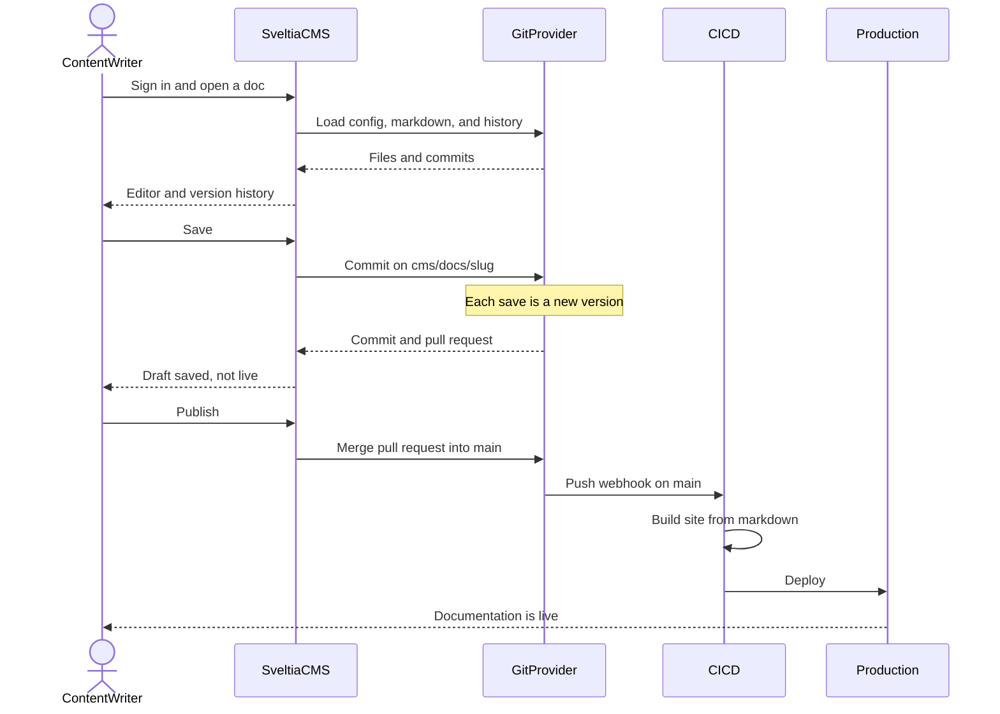

# Sveltia CMS docs publish flow

Yes. Headless [Sveltia CMS](https://sveltiacms.app/en/) fits content writers writing documentation, saving versions, and deploying only when they publish.

Sveltia is a Git-backed editor, not a database. It already supplies the admin UI and the Git API. You do not need a custom editor or content server for this flow. You still own CI and hosting: Sveltia never deploys by itself.

## How the three requirements map

- **Write documentation.** Writers sign in with GitHub, GitLab, or Gitea/Forgejo and edit a Markdown collection in the Sveltia admin UI (`admin/index.html` + `config.yml`).
- **Save with a version.** Editorial Workflow (`publish_mode: editorial_workflow`) commits each Save onto a branch such as `cms/docs/<slug>` and opens a pull request. Another Save adds another commit. The History panel lists author and date. That commit history is the version record.
- **Publish deploys production.** Publish merges the pull request into the configured branch (usually `main`) and deletes the draft branch. A push to `main` is what your CI (GitHub Actions, GitLab CI, or similar) builds and deploys. Draft saves stay off `main`, so they do not go live.

## What you would still add

- A docs collection in `config.yml` (`folder: content/docs`, `publish_mode: editorial_workflow`).
- CI on `main` only, so merge is the production deploy. Optional preview builds on `cms/**` pull requests.
- Git accounts for writers. Sveltia has no separate user database; repo permissions are the roles.

A custom server, editor, or version API is optional. Add one only if you later need logins outside Git or versions stored somewhere other than commits.
